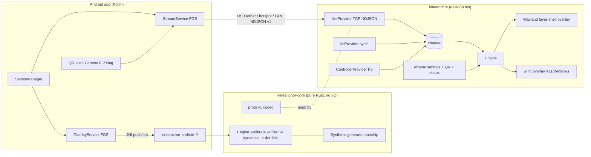
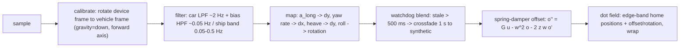

# KineAnchor — Architecture (draft v0, for review)

FOSS cross-platform equivalent of Apple Vehicle Motion Cues. License: GPL-3.0-or-later.
Peripheral dots drift against vehicle motion so visual input agrees with the vestibular system.

---

## 1. Tech validation

### 1.1 UI toolkit: egui vs GPUI — verdict: **egui, but narrower than assumed**

| Criterion | egui / eframe | GPUI |
|---|---|---|
| Linux Wayland layer-shell | Not via eframe/winit (winit has no layer-shell API; long-standing open request). Possible by driving `egui` + `egui-wgpu` on a raw SCTK surface (precedent: `wayapp` crate, SCTK `wlr_layer` examples). | No layer-shell; tied to Zed's own platform layer. |
| X11 / Windows overlay | `ViewportBuilder::with_transparent(true)`, `with_mouse_passthrough(true)`, `with_always_on_top()`, `with_decorations(false)` — proven path. | Transparency exists; click-through not exposed as a public API. |
| Android | `eframe` runs in a `NativeActivity`/`GameActivity` only. **Cannot** host a `TYPE_APPLICATION_OVERLAY` window from a Service. | `gpui-mobile` is community/experimental; same Activity-only limitation, no overlay story. |
| Maturity / docs / license | Mature, MIT/Apache-2.0. | Zed-coupled API churn, Apache-2.0. |

Decision:
- **egui** for desktop settings UI (normal eframe window) and as the shared **dot painter** (`egui::Painter::circle_filled`) on every desktop overlay backend.
- **Linux Wayland overlay**: SCTK layer surface + `egui` + `egui-wgpu` (no winit). The overlay takes no input, so no input translation is needed and glue stays small.
- **Android**: **Kotlin shell + Rust core via JNI**, not eframe. Reason: an overlay must be a `View` added by `WindowManager.addView(TYPE_APPLICATION_OVERLAY)` from a foreground Service. android-activity/winit binds to the Activity's `ANativeWindow` and has no path to that. Drawing ~100 circles on an Android `Canvas` is trivial, so wgpu on Android is not needed.
- GPUI rejected: no advantage on any target, more risk on all of them.

### 1.2 Wayland layer-shell in Rust

- Crates: `smithay-client-toolkit` (MIT) for registry/outputs/`zwlr_layer_shell_v1`, `wgpu` + `egui-wgpu` for rendering, `raw-window-handle` to build the wgpu surface from the `wl_surface`.
- Per output: one layer surface, `Layer::Overlay`, anchored to all 4 edges, size `0x0` (compositor fills the output), `exclusive_zone = -1`, `KeyboardInteractivity::None`.
- Click-through: `wl_surface.set_input_region(empty_region)`.
- Frame pacing: `wl_surface.frame` callbacks; skip redraw when offset delta < 0.5 px (battery).
- Transparency: wgpu `CompositeAlphaMode::PreMultiplied` (Vulkan on Wayland supports it). Fallback if a driver refuses: `wl_shm` + `tiny-skia` CPU raster, drawing only the edge band at 30 fps.
- Compositor coverage: KWin (Plasma 6), Sway, Hyprland, Wayfire, river, niri, labwc — all implement wlr-layer-shell.
- GNOME/Mutter: no layer-shell (refused upstream). Stretch: GNOME Shell extension (GJS, `reactive=false` actor) that receives dot frames over a local socket. Interim spike: X11 backend under XWayland (always-on-top + XShape input passthrough), unverified on Mutter.
- Reuse first: evaluate `wayapp` crate in the P1 spike. Only write custom SCTK glue if it does not fit (estimate ~300 lines).

### 1.3 Android overlay + sensor stream feasibility — feasible, with known traps

- Overlay: `SYSTEM_ALERT_WINDOW` (user grants in Settings via `ACTION_MANAGE_OVERLAY_PERMISSION`). Window flags `FLAG_NOT_TOUCHABLE | FLAG_NOT_FOCUSABLE | FLAG_LAYOUT_IN_SCREEN`.
- **Android 12+ untrusted-touch rule**: touches pass through an overlay from another UID only if window `alpha <= InputManager.getMaximumObscuringOpacityForTouch()` (0.8 default). The window alpha must be capped at 0.8, otherwise the phone becomes untouchable under the dots.
- Foreground service: Android 14 requires `foregroundServiceType`. Use `specialUse` with `FOREGROUND_SERVICE_SPECIAL_USE`. The Play-policy review for that type does not apply on F-Droid.
- Sensors: `TYPE_LINEAR_ACCELERATION`, `TYPE_GYROSCOPE`, `TYPE_GRAVITY` at `SENSOR_DELAY_GAME` (~50 Hz). Rates above 200 Hz need `HIGH_SAMPLING_RATE_SENSORS`, which is not needed here. Hold a `PARTIAL_WAKE_LOCK` while streaming with the screen off (non-wakeup sensors stop when the AP suspends).
- Network: plain `java.net.Socket` / `ServerSocket`, `INTERNET` permission only. No Google services.
- QR scanning offline: CameraX (AndroidX, Apache-2.0) + ZXing core (Apache-2.0). **Not** ML Kit (Google proprietary).
- Tethering cannot be enabled programmatically without root. Deep-link chain: explicit `com.android.settings.TetherSettings` component, then `Settings.ACTION_WIRELESS_SETTINGS`, then `Settings.ACTION_SETTINGS`.

---

## 2. System architecture



### 2.1 Workspace layout (3 crates + Android project)

```
Cargo.toml                      # workspace
crates/
  kineanchor-core/              # pure: types, proto v1, calibration, filters, synthetic, dot field, config (serde)
  kineanchor/                   # desktop bin: providers, overlay backends, eframe settings, pairing
  kineanchor-android-ffi/       # cdylib, `jni` crate, ~5 exported functions
android/                        # Gradle, Kotlin, plain Views (no Compose needed)
packaging/linux/                # .desktop, polkit policy, netsetup helper, NM profile, ufw + firewalld service files, PKGBUILD
packaging/windows/              # cargo-wix / winget manifest
fastlane/metadata/android/      # F-Droid metadata (in-repo)
docs/ARCHITECTURE.md ROADMAP.md PROTOCOL.md
tests/vectors/*.ndjson          # golden protocol vectors shared by Rust + Kotlin tests
```

The protocol stays a module inside `kineanchor-core` (pure parse/serialize, no sockets), so no separate crate is needed.

### 2.2 Core API (sketch)

```rust
// Units: accel m/s^2, gyro rad/s, time seconds. Device frame = Android convention
// (x right, y toward top edge, z out of screen).
pub struct MotionSample { pub t: f64, pub ax: f32, pub ay: f32, pub az: f32,
                          pub gx: f32, pub gy: f32, pub gz: f32,
                          pub gravity: Option<[f32; 3]> }

pub enum Vehicle { Car, Ship }
pub enum Source  { Sensor, Synthetic }          // "manual" = Synthetic with user-tuned params

pub struct Config { pub vehicle: Vehicle, pub source: Source,
                    pub density: f32, pub dot_radius_px: f32, pub opacity: f32,
                    pub color: [u8; 4], pub edge_band: f32, pub gain: f32,
                    pub invert: [bool; 3], pub synthetic: SyntheticParams, /* ... */ }

pub struct Dot { pub x: f32, pub y: f32, pub r: f32, pub alpha: f32 }
pub enum Status { Live { rate_hz: f32 }, Stale { since: f64 }, Synthetic, Calibrating }

pub struct Engine { /* calibration, filters, spring state, dot field, watchdog */ }
impl Engine {
    pub fn new(cfg: Config) -> Self;
    pub fn set_config(&mut self, cfg: Config);
    pub fn push(&mut self, s: MotionSample, arrival: f64); // any thread feeds via channel; engine is single-owner
    pub fn zero(&mut self);                                 // capture rest gravity + bias
    pub fn tick(&mut self, now: f64, viewport: [f32; 2]) -> (&[Dot], Status);
}
```

### 2.3 Provider trait (desktop crate, owns I/O)

```rust
pub enum ProviderEvent { Sample(MotionSample), Connected(String), Disconnected(String) }

pub trait Provider: Send {
    fn name(&self) -> &'static str;
    /// Blocking loop on its own thread; returns when `stop` is set.
    fn run(self: Box<Self>, tx: std::sync::mpsc::Sender<ProviderEvent>, stop: Arc<AtomicBool>);
}
// impls: NetProvider (phone stream), IioProvider (/sys/bus/iio raw+scale), ControllerProvider (P5)
```

The synthetic generator is **not** a Provider thread. It lives in core, because it is the fallback and must work when every provider thread is dead or stuck. It uses the same `MotionSample` output, so the blend logic sees one type.

### 2.4 Engine pipeline



- **Calibration**: `zero()` stores the rest gravity direction (down axis) and gyro bias. Forward axis MVP = horizontal projection of device `+y` or `-z`, whichever has the larger horizontal component. This covers both a flat phone with its top toward the front and a phone upright in a holder. Auto-detection from dominant longitudinal acceleration (PCA) comes in P5.
- **Yaw** = gyro projected on the gravity axis, so yaw does not depend on how the phone is mounted.
- **Apple convention** (default; per-axis invert in config): accelerate → dots down, brake → dots up, turn left → dots right, turn right → dots left.
- **Spring-damper** keeps dots from drifting off-screen during sustained input. Car: stiffer/faster. Ship: softer/slower, plus rotation from roll.
- **Never freeze**: `tick()` always returns a frame. Status changes; rendering does not stop.

### 2.5 Desktop process model

- One process: eframe settings window on the main thread (normal xdg-toplevel / Win32 window). The overlay backend runs on its own thread with its **own** Wayland connection; several `wl_display` connections per process are legal. The engine is owned by the overlay thread. Config and status pass through `Arc<Mutex<Config>>` and an mpsc channel.
- Backend selection: `WAYLAND_DISPLAY` set and `zwlr_layer_shell_v1` advertised → layer-shell. Wayland without layer-shell (GNOME) → X11 backend via XWayland, with a warning. Otherwise → X11 / Win32 winit backend.
- Tray (StatusNotifierItem via `ksni`) and a global toggle hotkey (xdg-desktop-portal GlobalShortcuts) come in P5.
- Config: TOML in the XDG config dir (`directories` crate).

---

## 3. Transport protocol v1

Specified in [PROTOCOL.md](PROTOCOL.md): plain TCP, newline-delimited JSON, token pairing via QR, ~50 Hz `MotionSample` lines.

---

## 4. Linux integration (CachyOS gotchas)

- **Tether interface name is not stable** (`usb0`, `enp0s20f0u1`, ...). Ship a NetworkManager keyfile that matches by driver, not by name:
  ```ini
  [connection]
  id=KineAnchor phone tether
  type=ethernet
  autoconnect-priority=-10
  [match]
  driver=rndis_host;cdc_ncm;cdc_ether
  [ipv4]
  method=auto
  route-metric=2000        # or never-default=true, see open question
  [ipv6]
  method=auto
  route-metric=2000
  ```
- **Firewall**: ship `/etc/ufw/applications.d/kineanchor` and `/usr/lib/firewalld/services/kineanchor.xml`. Distro packages must not open ports in post-install (Arch packaging policy). Instead, the first-run button "Enable phone connection" runs `pkexec /usr/lib/kineanchor/kineanchor-netsetup`: **one polkit prompt**, a fixed helper with no free-form arguments. The helper installs the NM profile and opens the port in whichever of ufw/firewalld is active.
- **Charge-only cable detection**: watch udev. An Android USB device appears with no new net interface → "Turn on USB tethering" (deep-link hint). No USB device appears at all → "Cable may be charge-only".
- Flatpak cannot run the polkit helper. Distro package (AUR/CachyOS repo) is the primary channel; Flatpak only if the phone-dials-desktop direction is chosen (no firewall change needed).

---

## 5. Licensing

- App: GPL-3.0-or-later. SPDX headers in every file.
- Allowed dependency licenses (`cargo-deny` gate in CI): MIT, Apache-2.0, BSD-2/3-Clause, ISC, Zlib, Unicode-3.0, MPL-2.0, GPL-3.0(-or-later), LGPL-3.0. **Denied**: GPL-2.0-only, LGPL-2.1-only, AGPL, proprietary.
- Android: ZXing core and CameraX (Apache-2.0) are compatible with GPLv3. No GMS/Firebase/ML Kit.
- Prior art (cited in README; no code copied unless its license is verified compatible):
  - `dev.davidv.motionsickness` (DavidVentura/motion-sickness-app) — **GPL-3.0-only**. Copying code would force the combined work to GPL-3.0-only, so reference only.
  - monperrus/motion-cues (X11/PyQt6 Linux port), smithynb/motion-cues, Exudius/motionsick, KineStop, EasyQueasy, MotionEase — licenses to verify before any reuse.
- Science: Diels & Howarth (2013), frequency characteristics of visually induced motion sickness, peak ~0.2 Hz. See the caution about synthetic mode in ROADMAP.
