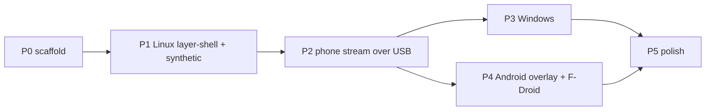

# KineAnchor — Roadmap, risks, open questions (draft v0)

Companion to [ARCHITECTURE.md](ARCHITECTURE.md). Protocol details: [PROTOCOL.md](PROTOCOL.md).

Environment observed on the dev laptop: KDE Plasma 6.8.1 on Wayland, rustc 1.98, **no IIO devices** (`/sys/bus/iio/devices` empty, iio-sensor-proxy inactive), **ufw active / firewalld inactive**, NetworkManager, Tailscale, predictable interface names.

---

## Open questions

> [!NOTE]
> The plan was approved without explicit answers, so the recommended default is applied for every question below: Q1 low-amplitude experimental synthetic mode with fallback to static dots; Q2 phone listens, desktop dials, desktop-listens as fallback; Q3 `route-metric=2000`; Q4 optional gravity fields; Q5 top-edge-forward mounting; Q6 Kotlin sender; Q7 `io.github.nandazahran.kineanchor`, binary `kineanchor`, port 47474; Q8 AUR first. Any of these can still be changed.

> [!CAUTION]
> **Q1: Synthetic 0.2 Hz sway may cause sickness instead of preventing it.** Diels & Howarth (2013) found 0.2 Hz to be the band where *visual* oscillation is most nauseogenic. A display oscillating at 0.2 Hz that is not phase-locked to real motion adds a visual–vestibular conflict. Proposal: keep the mode as you specified, but
> - default the synthetic amplitude low, label it "experimental", and add a slider down to 0 (static dots = stable earth-fixed reference);
> - on cable drop, fall back to **slow-decaying hold → static dots**, not 0.2 Hz sway.
>
> Accept, or keep 0.2 Hz sway as the fallback default?

> [!IMPORTANT]
> **Q2: Connection direction.** Your spec has the laptop listen on `0.0.0.0`. Alternative: the **phone listens and the laptop dials**. On USB tether and hotspot, the phone is always the laptop's default gateway on that interface, so the laptop finds it with zero config. Outbound connections need **no firewall rule** on ufw, firewalld, or Windows Defender. That removes the polkit firewall step and the Windows firewall prompt, and makes Flatpak viable. The QR still carries the pairing secret (scan once). For a shared Wi-Fi LAN (phone not gateway), the laptop-listens mode stays as a fallback. Recommendation: phone-listens primary, laptop-listens fallback. The protocol does not change.

> [!IMPORTANT]
> **Q3: `ipv4.never-default` vs high `route-metric`.** `never-default` means you can never use phone internet over USB. `route-metric=2000` gives the same result whenever Wi-Fi exists (Wi-Fi wins) and still allows phone internet when it is the only uplink. Recommendation: `route-metric`. Which one?

**Q4: Spec deviation.** The protocol adds optional `gvx,gvy,gvz` (TYPE_GRAVITY) to your `{ax,ay,az,gx,gy,gz,t}`. Without it the receiver cannot know phone orientation, because linear acceleration has gravity removed. OK?

**Q5: Phone mounting assumption for MVP.** Phone top edge points to the vehicle front (flat or upright in a holder). Auto-detection of the forward axis comes in P5. OK for MVP?

**Q6: Android stream sender in Kotlin (~150 lines) vs Rust via JNI.** Sensor callbacks are Kotlin anyway, and golden vectors keep both sides honest. The Rust core is still used on the phone for the overlay via JNI. Recommendation: Kotlin sender.

**Q7: IDs and naming.** App ID `io.github.nandazahran.kineanchor`, binary `kineanchor`, default port 47474?

**Q8: Distribution priority on Linux.** AUR first (then CachyOS repo request); Flatpak only if Q2 = phone-listens?

---

## Risk list

| # | Risk | Impact | Mitigation |
|---|---|---|---|
| R1 | KWin layer-shell `overlay` layer stacking vs fullscreen windows differs from wlroots | Dots hidden in fullscreen video/games | P1 manual matrix; document per-compositor behaviour |
| R2 | wgpu premultiplied alpha unsupported on some Wayland driver | Opaque black overlay = unusable | Startup check of `surface.get_capabilities().alpha_modes`; fall back to `wl_shm` + tiny-skia |
| R3 | GNOME has no layer-shell | No native overlay on GNOME | XWayland X11 backend spike; Shell extension in P5; MVP not blocked |
| R4 | Multi-monitor, hotplug, fractional scaling | Wrong size/blurry/missing dots | One surface per `wl_output`; handle `wp_fractional_scale_v1`; hotplug test |
| R5 | Laptop has no IMU (confirmed on dev laptop) | Sensor-follow mode unavailable locally | Phone puck is primary; synthetic always available; IIO provider optional |
| R6 | Laptop IMU sits in the lid and moves with it, usually accel only (no gyro) | Noisy/partial input | Low priority; yaw from accel impossible, so mark as "accel-only" |
| R7 | Tether interface name unstable (`usb0` vs `enp*u*`) | NM profile/firewall rule misses | Match by driver (`rndis_host;cdc_ncm;cdc_ether`); firewall by port, zone optional |
| R8 | Tether becomes default route and stalls internet | User blames app | NM profile route-metric/never-default (Q3) |
| R9 | Charge-only cable / tethering left off | "Doesn't work" | udev detection + specific UI message; Android `USB_STATE` sticky broadcast hint |
| R10 | Android tethering subnet randomized (Android 11+) | Hardcoded IP breaks | Never hardcode; gateway discovery (Q2) or QR IP |
| R11 | Android cannot auto-enable tethering | Extra tap | Deep-link chain to Tether settings; documented 3-tap flow |
| R12 | Android 12+ untrusted-touch blocking | Phone untouchable under overlay | Cap overlay window alpha ≤ 0.8; test on Android 12+ |
| R13 | OEM battery killers (MIUI, OneUI, ColorOS) kill FGS | Stream/overlay dies | FGS + partial wake lock + battery-optimization exemption prompt; dontkillmyapp link |
| R14 | Sensors stop with screen off | Stream stalls | `PARTIAL_WAKE_LOCK` while streaming; watchdog fallback on desktop anyway |
| R15 | Plaintext LAN listener on public Wi-Fi (e.g. eduroam) | Fake motion injected; port exposure | Token auth, 1 client, bounded lines, listener only in phone mode, Q2 removes the listener |
| R16 | F-Droid build of Rust+NDK | Release blocked | cargo-ndk with pinned toolchain; commit `Cargo.lock` (currently gitignored, must change); test with fdroidserver locally |
| R17 | Synthetic mode provokes sickness | Harms the user | Q1 |
| R18 | Hand-held phone jitter in overlay mode | Dots twitch | Car LPF + deadband; tune with recordings |

---

## Phased MVP

### P0 — Scaffold (small)
- Cargo workspace, 3 crates; un-ignore `Cargo.lock`; SPDX headers; `cargo-deny` config; CI (Linux, Windows build; clippy, tests, deny).
- **Exit**: `cargo test --workspace` and `cargo deny check licenses` green.

### P1 — Linux layer-shell + synthetic (usable with no sensor)
- Core: config, synthetic generator (car/ship/manual), spring-damper, dot field, record/replay of `MotionSample` NDJSON (doubles as test fixtures).
- Desktop: spike `wayapp` vs custom SCTK glue → layer-shell overlay (per output, click-through, overlay layer); X11 winit fallback; eframe settings (density, size, opacity, color, edge band, vehicle, source, amplitude); config persistence; `.desktop` file.
- **Exit**: on Plasma 6 Wayland, dots draw over all windows, clicks and keyboard pass through, settings apply live, idle CPU < 3 %.

### P2 — Phone stream over USB tether
- Core: proto v1 codec, calibration/zero, sensor filter paths, watchdog + crossfade.
- Desktop: NetProvider (TCP NDJSON, token auth, single client), QR pairing window (`qrcode` crate), status dot (green live / amber stale / red none), udev cable hint, NM profile + polkit `kineanchor-netsetup` helper, ufw/firewalld service files, PKGBUILD.
- Minimal Android sender app (Kotlin): QR scan, StreamService FGS, tether deep link, zero button. This is the first piece of P4, released as a debug APK only.
- `examples/fake_phone.rs`: replays a recorded NDJSON stream to the desktop, so desktop work never needs the phone.
- **Exit**: plug → tether → scan → dots follow real car motion; pull cable → fallback within 500 ms, no freeze; replug → auto-reconnect without re-pairing.

### P3 — Windows
- winit backend: transparent, mouse passthrough, always-on-top, borderless, covers each monitor; per-monitor DPI.
- Packaging: MSI (cargo-wix) + winget manifest. Firewall prompt only if Q2 = laptop-listens.
- **Exit**: same behaviour as P1/P2 on Windows 11 over borderless-fullscreen apps. Exclusive-fullscreen games are documented as unsupported.

### P4 — Android overlay + F-Droid
- OverlayService (`specialUse` FGS, `TYPE_APPLICATION_OVERLAY`, alpha ≤ 0.8, Choreographer-driven Canvas view); JNI `push/tick/zero/set_config`; settings screen; mode switch "Overlay on this phone" / "Stream to PC".
- F-Droid: fastlane metadata, fdroiddata recipe (cargo-ndk), reproducible-build check, no anti-features.
- **Exit**: overlay works over other apps with touches passing through; survives 30 min screen-on/off; `fdroid build` succeeds locally.

### P5 — Polish
- Ship tuning from real ferry recordings (heave/roll/pitch, 0.1–0.3 Hz band).
- Forward-axis auto-detection; mDNS `_motionsync._tcp`; tray (`ksni`); portal global shortcut toggle.
- Controller gyro backend (DualSense via hidapi/SDL); IIO laptop provider.
- GNOME Shell extension (stretch).

---

## Test plan per phase

| Phase | Automated | Manual |
|---|---|---|
| P0 | `cargo test --workspace`, `cargo clippy -- -D warnings`, `cargo deny check` in CI | — |
| P1 | Core unit tests: synthetic frequency via zero-crossings ≈ configured Hz; spring offset bounded for step/ramp input; dot positions stay inside edge band; config TOML round-trip. **Offline proof**: `unshare -rn ./kineanchor --synthetic` runs (Wayland socket is a Unix socket, so it works inside a network namespace). Headless smoke: `WLR_BACKENDS=headless sway` + `grim` screenshot shows non-transparent pixels in the edge band. | Plasma 6: click-through on browser/terminal, typing unaffected, over fullscreen video, 2 monitors + hotplug, fractional scale 1.25. Nested Sway/Hyprland windows under KDE for the compositor matrix. |
| P2 | Golden vectors `tests/vectors/*.ndjson` parse identically in Rust and Kotlin; codec rejects >1024 B lines, bad `v`, bad token; **cable-drop unit test** with a fake clock: samples stop → status `Stale` at 500 ms → synthetic/static blend reaches 100 % at 1.5 s → `tick()` never returns an empty frame; reconnect test with `fake_phone` killed and restarted (integration test over loopback). Calibration test: rotated recorded stream yields the same vehicle-frame output as the unrotated one. | Real car drive with recording on; physically pull the cable mid-drive; phone mobile data **off** + laptop Wi-Fi **off** (fully offline); charge-only cable shows the right message; internet over Wi-Fi keeps working while tethered (R8). |
| P3 | Windows CI build + core tests on `windows-latest` | Click-through, always-on-top over borderless-fullscreen browser, mixed-DPI monitors, fake_phone stream |
| P4 | Kotlin unit tests on golden vectors; JNI smoke test (instrumented); `fdroid lint` + local `fdroid build` | Android 12+ touch pass-through; screen off 30 min; airplane mode + USB tether; one OEM-skin device if available; permission denial paths |
| P5 | Replay ferry recordings through ship mode: output energy concentrated in 0.1–0.3 Hz | Real ship/ferry trip; controller hotplug; GNOME extension on GNOME 47+ |

---

## After approval (P0 only, then stop for review again)
1. Copy `ARCHITECTURE.md` + `ROADMAP.md` to `docs/`; add `docs/PROTOCOL.md` (section 3 split out).
2. Fill `.projectmem/plan.md`, `PROJECT_MAP.md`; log decisions (egui desktop / Kotlin+JNI Android, NDJSON-TCP v1, answers to Q1–Q3).
3. P0 scaffold as above.
